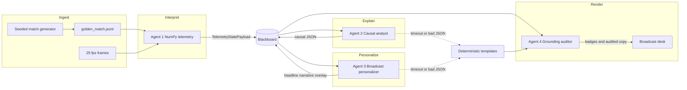

# Touchline AI

A synthetic-match desk that turns a 90-minute event stream into a broadcast. One NumPy engine measures the match. Four agents share a blackboard. A grounding auditor deletes any number the stream cannot prove. The screen is a live studio: pitch, lower-third, personas, and a trace of what each agent actually took.

North London Red against Manchester Blue. No real clubs. The famous minutes — 22', 54', 67', 82', 90' — are not hard-coded captions. They fall out of the formulas.

## Elevator pitch

Commentators and fans get a why, not a spreadsheet. Touchline watches a rolling five-minute window against the fifteen minutes before it, names the tactical turn (press, inversion, collapse, pace), and says it in the voice of a casual fan, a tactico analyst, or a broadcast studio, in English, Spanish, or Arabic. Every badge on the lower third is a number the engine just computed. If the language model invents one, it does not air.

## Microsoft technologies

| Technology | How this project uses it |
| --- | --- |
| **Semantic Kernel** | The runtime orchestrator. `Kernel`, `ChatCompletionAgent`, and `OpenAIChatCompletion` run Agent 2 (causal analyst) and Agent 3 (broadcast personalizer) against an OpenAI-compatible endpoint. Temperature is 0.2 and responses are JSON. |
| **GitHub Actions** | `.github/workflows/ci.yml` installs the Python stack, runs pytest, and builds the Vite UI on every push and pull request. |
| **VS Code + GitHub Copilot** | `.vscode/extensions.json` recommends Copilot, Copilot Chat, and the Python extension. The repo is laid out as a normal VS Code workspace (`pyproject.toml`, `requirements.txt`, a `frontend/` app) so Copilot can complete agents, prompts, and UI in context. |
| **GitHub** | Source, review, and the CI log are the production record of the build. |

Semantic Kernel is pinned to **1.18.0**. That release still has `ChatCompletionAgent` (the method is `invoke`, which is what this code calls). Later releases pull in SciPy, PyAV, and Azure extras and unzip past Vercel's 500 MB Python function limit. 1.18 plus FastAPI, NumPy, and the OpenAI client lands near 200 MB, so the orchestrator on the critical path really is Semantic Kernel, and the function still fits.

## Architecture



The blackboard is `MatchBlackboardState`: telemetry, causal diagnosis, personalization, audit, errors, and an explicit handoff log. Agent 4 always runs. A missing `AIML_API_KEY`, a timeout, or JSON that will not parse is a recorded error and a handoff to the template, not a dead screen. The brief names 4.0 seconds. Completions on this route measure about 5 seconds, so each agent is allowed 8 seconds before that handoff. The template path itself stays under 20 ms.

## Five-stage pipeline

| Stage | Where it lives |
| --- | --- |
| **Ingest** | `backend/synthetic/match_generator.py` writes `golden_match.jsonl` (seed 2026). Auto-eventing ingests unlabeled 25 fps frames. |
| **Interpret** | Agent 1, `backend/engine/telemetry_engine.py`, using the NumPy formulas in `backend/engine/formulas.py`. |
| **Explain** | Agent 2, a Semantic Kernel chat agent. The system prompt is the causality brief in `backend/agents/prompts.py`. |
| **Render** | The pitch, the ghost-to-active movement, the lower-third, and the copyable overlay JSON. Agent 4 strips ungrounded numbers before anything is rendered. |
| **Personalize** | Agent 3 rewrites the explanation for persona, favourite club (we / our), spotlight player, and language (`en`, `es`, `ar` with RTL). |

## Agents

1. **Telemetry engine** — windows, PPDA, possession, xT, CCI, centroids, pass difficulty, sprint and shot speed. No language model.
2. **Causal analyst** — why the anomaly matters. May cite only numbers present in the payload. Says so when the question is about heart rate, injury, or the dressing room.
3. **Broadcast personalizer** — headline of at most 12 words, narrative of at most 55, overlay coordinates copied from the payload.
4. **Grounding auditor** — a number survives only when some payload value is within ±0.5. Anything else becomes `[unverified]`. Badges are formatted from engine fields, so they verify by construction.

Latencies on the agent rail are `time.perf_counter` measurements for that request, including the fast template path.

## Formulas

Pitch coordinates are metres, X from 0 to 120, Y from 0 to 80 with 0 at the top. North London Red attack toward x = 120 for the whole match. There is no half switch.

Windows, with the clock parked at `minute:59` so the action inside that minute counts:

- Active: `(now − 300s, now]`
- Baseline: `(now − 1200s, now − 300s]`

```
PDR = clip(0.75 * d_pass + 11.5 * N_bypassed + 28 / max(1, d_pressure) + 12 * [x2 > 80], 0, 100)
```

`N` is the count of opposition players whose x lies strictly between the passer and the receiver. Pressure is the nearest opponent to the receiver. With no opponents it defaults to 5 m.

```
v_kmh = distance_m / Δt_s * 3.6
sprint if v ≥ 31.5 km/h or 5-minute distance ≥ 625 m

PPDA = opposition passes outside the defensive third / defensive actions
```

NLR's defensive third is `x ≤ 40`. MCB's is `x ≥ 80`. PPDA is undefined when there are no defensive actions.

```
CCI = clip(4.5 * turnovers_5m + 0.65 * mean_ball_speed_5m + 120 / max(4, PPDA), 0, 100)
```

The PPDA in that expression is the team with less possession. Under 35 is high positional control, 35 to 65 is a balanced rhythm, over 65 is end-to-end chaos.

A structural shift is a centroid move of at least 15 m. The 54' inversion also requires a full-back moving inward and a numerical overload in zone 14 (`x` 54–82, `y` 32–56).

```
xG = clip((36 − distance_to_goal_centre) / 40, 0.02, 0.55)
```

xT is a 12×8 grid. The cells used by the scripted central passes are calibrated so the 54' central xT move is exactly +340%.

Auto-eventing emits a pass or a shot only when the ball goes from inside 1.5 m of a player to outside 2.0 m and ball acceleration exceeds 8 m/s². Frames carry no event label. A sprint is any player at or above 31.5 km/h.

### Badges the engine produces

| Minute | What the desk shows |
| --- | --- |
| 22' | NLR PPDA 5.8, shot 104.2 km/h, pass difficulty 82.4. Score 1-0. High press. |
| 54' | #2 shifts 26.2 m inside, NLR PPDA 8.4 → 15.2, central xT +340% (0.48), line-break PDR 86.5. CCI 24.5. Score 1-0. |
| 67' | CCI 79.4, left-flank press −64%, final-third entries 0. Score 1-1. |
| 82' | #19 sprint 33.8 km/h, #8 line-break PDR 91.2, ball 74.6 km/h. Score 2-1. |
| 90' | xG NLR 1.84 – MCB 1.42, peak PDR 91.2, 4 tactical shifts. |

## Run locally

Python 3.12 and Node 22.

```bash
python -m venv .venv
source .venv/bin/activate
pip install -r requirements-dev.txt
pytest -q

# Optional. The UI ships a committed cache; regenerate after copy changes.
python scripts/build_fallback_cache.py

cd frontend
npm ci
npm run build
cd ..

# AIML_API_KEY=            empty is a complete demo
uvicorn backend.main:app --host 127.0.0.1 --port 8000
```

Open `http://127.0.0.1:8000`. For UI hot reload, run `npm run dev` in `frontend/` and keep the API on port 8000. Vite proxies `/api`.

Copy `.env.example` to `.env` if you want a key. The process reads `AIML_API_KEY` and nothing else. Do not commit `.env`.

`POST /api/analyze-moment`, `POST /api/diagnose-struggle`, `POST /api/auto-event`, `GET /api/recap`, `GET /api/telemetry`, `GET /api/live/stream`, and `GET /api/health` are the surface. The same routes also exist without the `/api` prefix.

## Deploy to Vercel

One project. The FastAPI app is the Vercel Python function and it serves the Vite build.

| Setting | Value |
| --- | --- |
| Framework preset | FastAPI |
| Root directory | repository root (not `frontend/`) |
| Install command | `pip install -r requirements.txt` |
| Build command | `python scripts/build_fallback_cache.py && cd frontend && npm ci && npm run build` |
| Output directory | leave empty. `app.frontend("/", directory="frontend/dist", fallback="index.html")` serves the UI |
| Entrypoint | `api.index:app` via `[tool.vercel]` in `pyproject.toml` |
| Environment variable | `AIML_API_KEY` (optional; empty still demos) |
| Function duration | 60 seconds on `api/index.py`, set in `vercel.json` |
| Python | 3.12 (`.python-version`) |

`vercel.json` sets `"framework": "fastapi"` and `"fluid": true`. Do not put the API key in that file.

A local check of the same pieces is `pytest -q` and `npm run build`, then `GET /` from the FastAPI app, which returns the built `index.html`.

## API shape

`POST /api/analyze-moment`

```json
{
  "minute": 54,
  "persona": "TACTICO_ANALYST",
  "favorite_club": "NLR",
  "spotlight_player_id": "MCB_02",
  "language": "en",
  "custom_question": null
}
```

Personas: `CASUAL_FAN`, `TACTICO_ANALYST`, `BROADCAST_STUDIO`. Languages: `en`, `es`, `ar`. Clubs: `NLR`, `MCB`.

The response carries the headline, narrative, why-it-matters, verified badges, overlay JSON, the telemetry payload, the 22 positions, the handoff log, and the four measured latencies. `mode` is `semantic_kernel` or `fallback`.

`GET /api/live/stream?start_minute=54&speed=10` is server-sent events. 1x is one match-minute per second. Playback uses this stream so a full match does not fire ninety language-model calls. The four-agent briefing runs on the bookmarks.

## Tests

```bash
pytest -q
```

- `tests/test_grounding_auditor.py` injects numbers that are not in the payload and asserts they are stripped.
- `tests/test_telemetry.py` checks the formulas.
- `tests/test_golden_moments.py` checks 22', 54', 67', 82', and the full-time rollup.
- `tests/test_fallback.py` clears `AIML_API_KEY` and covers moments, personas, languages, the club voice, the spotlight, an unanswerable question, the 20 ms template budget, and a timeout handoff.
- `tests/test_api.py` hits health, analyze, diagnose, recap, telemetry, SSE, and auto-eventing.

## Screenshots

Broadcast frames at 1920×1080 from the local desk. Replace the paths below with the artifact files from the demo run.

| Frame | File |
| --- | --- |
| Landing, 54' | `artifacts/landing-54.png` |
| 22' high press | `artifacts/minute-22.png` |
| 67' why we are struggling | `artifacts/minute-67-struggle.png` |
| 82' pace | `artifacts/minute-82.png` |
| 90' three turning points | `artifacts/minute-90-recap.png` |
| Auto-event modal | `artifacts/auto-event.png` |
| Arabic, RTL | `artifacts/arabic-rtl.png` |
| Analyst persona | `artifacts/analyst.png` |
| Spotlight | `artifacts/spotlight.png` |

## Synthetic data

Every team, player, and event in this repository is synthetic. North London Red and Manchester Blue are not clubs. Names that end in `-Style`, including B. Saka-Style, K. Walker-Peters, M. Odegaard-Style, and E. Haaland-Style, are the fictional roster required by the brief. The match id is `pl_syn_2026_nlr_mcb`, seed 2026. Nothing here is a recording, a feed, or a trademark of a real competition. Do not add real crests, wordmarks, or league devices to the UI.
